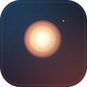
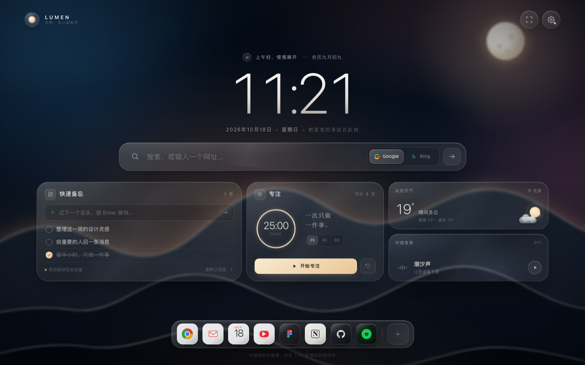
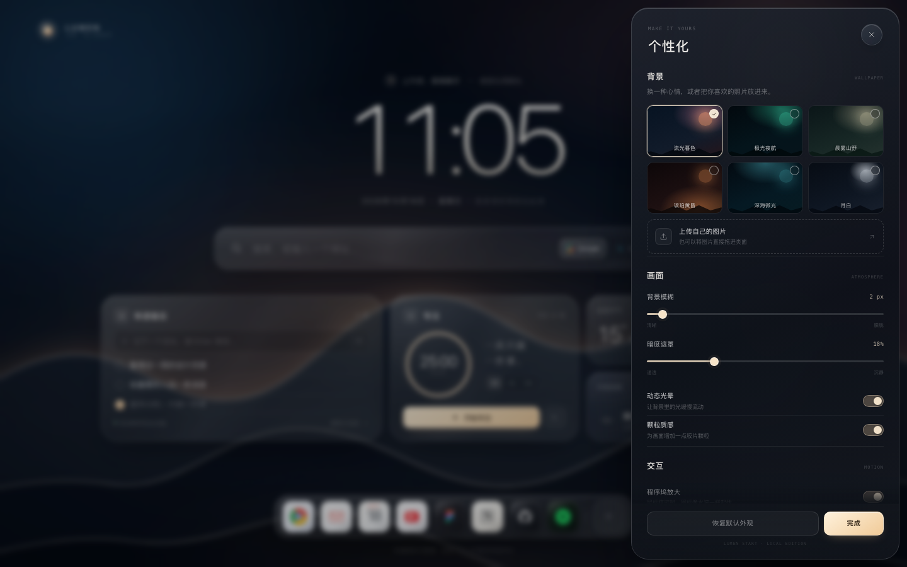
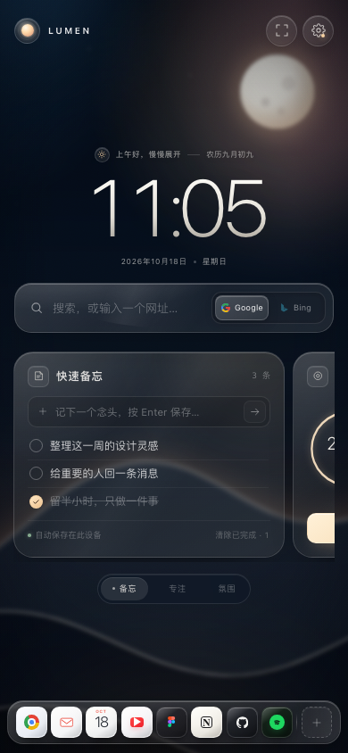

<div align="center">
  
  <h1>LUMEN · 光屿</h1>
  <p><strong>A quiet place to begin.<br>让每一次开始，都落在一座安静的小岛上。</strong></p>
  <p>
    <a href="#chinese">中文</a>
    &nbsp;·&nbsp;
    <a href="#english">English</a>
  </p>
  <p>
    <code>Manifest V3</code>&nbsp;&nbsp;
    <code>Chrome 120+</code>&nbsp;&nbsp;
    <code>0 permissions</code>&nbsp;&nbsp;
    <code>MIT</code>
  </p>
  <p>
    <a href="https://github.com/shilongWang1107/lumen-startpage/releases/latest"><strong>Download the extension&nbsp;&nbsp;·&nbsp;&nbsp;下载扩展</strong></a>
  </p>
</div>



> **LUMEN** is a new-tab extension built around one idea: the browser’s first blank page should feel like a room, not a dashboard.
>
> **LUMEN** 是一个 Chrome 新标签页扩展：浏览器的第一块空白，应该像一间房间，而不是一块仪表盘。

---

<a id="chinese"></a>

## 中文

### 安装

**下载打包版**

前往 [最新 Release](https://github.com/shilongWang1107/lumen-startpage/releases/latest) 下载 `lumen-startpage-v1.0.0.zip`，解压后按下方步骤加载。

**从源码加载（本地开发）**

1. 下载本仓库，或点击 GitHub 的 **Code → Download ZIP** 后解压。
2. 打开 `chrome://extensions`，开启右上角的 **开发者模式**。
3. 点击 **加载已解压的扩展程序**，选择包含 `manifest.json` 的文件夹。
4. 打开一个新标签页，LUMEN 就会成为你的新标签页。

> Chrome 不允许直接双击安装第三方 `.crx`，本地使用「加载已解压」是正常路径。通过「加载已解压」安装时，扩展 ID 与目录路径有关；加载后尽量不要移动目录，否则本地已保存的备忘与设置可能不会沿用。
>
> 安装扩展后，建议到 `chrome://settings/onStartup` 选择「打开新标签页」，这样启动浏览器和新建标签页都会进入 LUMEN。直接打开的本地 `index.html` 与扩展页面属于不同来源，会各存一份本地数据。

**打包发布**

```bash
./scripts/package-extension.sh
# 生成 dist/lumen-startpage-v1.0.0.zip
```

将生成的 zip 上传至 [Chrome Web Store Developer Dashboard](https://chrome.google.com/webstore/devconsole) 即可发布；也可以把 zip 附加到 GitHub Release，方便别人下载后解压使用。

### 它是什么样的

- **一间安静的房间**：深夜蓝调、暖色月晕、远山、雾带和胶片颗粒组成流动的暮色场景。
- **有厚度的玻璃**：搜索框、小组件与程序坞都使用多层磨砂玻璃，带内侧高光、边缘反光和轻微色散。
- **macOS 式程序坞**：图标随鼠标位置起伏放大，邻近图标自然让位；悬浮标签、点击回弹、右键管理。
- **四个轻量小组件**：快速备忘、专注计时、实时天气、潮汐环境声。刚好填补搜索与程序坞之间的留白。
- **你的画面**：六套内置场景，也支持上传或拖入自己的照片；可调模糊、暗度、颗粒、动态光晕与视差。
- **没有多余请求**：扩展不申请任何权限；数据优先留在本机。

### 功能

| 模块 | 能力 |
| --- | --- |
| 新标签页 | 通过 `chrome_url_overrides` 接管 Chrome 新标签页；工具栏图标也能打开 LUMEN |
| 搜索 | 默认 **Google** / **Bing**，支持直接输入网址、备用引擎和本地快捷指令 |
| 快速备忘 | 新增、勾选、删除、撤销、清除已完成；自动保存在本机 |
| 专注计时 | 25 / 45 / 60 分钟，完成提示音与当日轮次统计 |
| 天气 | Open-Meteo 实时天气，点击卡片在四个城市之间切换；断网时自动回退 |
| 环境声景 | Web Audio 实时合成潮汐声，无音频文件、无额外下载 |
| 程序坞 | 自定义快捷入口、添加应用、删除撤销；最多 12 个 |
| 外观 | 背景模糊 0–40px、暗度 0–65%、动态光晕、颗粒质感、鼠标视差 |
| 响应式 | 窄屏下小组件转为可横滑卡片流，并配有切换胶囊 |

### 快捷键

| 操作 | 快捷键 |
| --- | --- |
| 唤起搜索 / 快捷指令 | `⌘K` / `Ctrl+K` 或 `/` |
| 在建议之间移动 | `↑` `↓` |
| 打开选中项 / 搜索 | `Enter` |
| 收起当前浮层 | `Esc` |
| 管理程序坞应用 | 在图标上右键 |

### 技术

纯 HTML / CSS / JavaScript，无框架、无构建步骤、无第三方运行时依赖。Manifest V3 扩展只包含一个页面和极简 service worker；毛玻璃效果基于 `backdrop-filter`，图标和壁纸均为本地资源。

### 隐私

LUMEN 没有账号、分析统计、广告或远程代码。备忘、设置、自定义背景与程序坞配置只写入当前浏览器的 Local Storage；唯一的网络请求是向 `api.open-meteo.com` 获取天气（使用固定城市坐标，不请求定位权限）。完整说明见 [PRIVACY.md](PRIVACY.md)。

---

<a id="english"></a>

## English

### Install

**Download the packaged build**

Get `lumen-startpage-v1.0.0.zip` from the [latest Release](https://github.com/shilongWang1107/lumen-startpage/releases/latest), then follow the steps below after unzipping it.

**Load from source (local development)**

1. Download this repository, or choose **Code → Download ZIP** on GitHub and unzip it.
2. Open `chrome://extensions` and enable **Developer mode**.
3. Choose **Load unpacked** and select the folder containing `manifest.json`.
4. Open a new tab. LUMEN is now your new tab page.

> Chrome does not allow double-clicking an external `.crx` to install it. **Load unpacked** is the normal local-development path. When loaded unpacked, the extension ID is tied to the folder path — avoid moving the folder afterwards if you want to keep your local notes and settings.
>
> After installing, set `chrome://settings/onStartup` to **Open the New Tab page** so both browser launch and new tabs use LUMEN. A standalone `index.html` and the extension page are different origins and keep separate local data.

**Build a release**

```bash
./scripts/package-extension.sh
# → dist/lumen-startpage-v1.0.0.zip
```

Upload the resulting zip to the [Chrome Web Store Developer Dashboard](https://chrome.google.com/webstore/devconsole), or attach it to a GitHub Release so people can download and unpack it.

### The idea

- **A quiet room** — a living twilight made of deep blue tones, a warm moon halo, layered mountains, haze and film grain.
- **Glass with weight** — the search bar, widgets and dock use layered frosted glass with inner light, edge reflections and a soft specular sheen.
- **A macOS-inspired dock** — icons rise and magnify around the cursor; neighbours gently make space. Hover labels, launch bounce and right-click management included.
- **Four small widgets** — quick notes, focus timer, live weather and generative surf. They occupy the space between the search bar and the dock with intention.
- **Your own scenery** — six handcrafted scenes, plus upload or drag-and-drop a personal photograph. Tune blur, dimming, grain, motion and parallax.
- **Nothing extraneous** — the extension requests no permissions and stores everything locally.

### Features

| Module | What it does |
| --- | --- |
| New tab | Takes over Chrome’s new tab via `chrome_url_overrides`; the toolbar icon opens LUMEN too |
| Search | **Google** and **Bing** by default, direct URL entry, alternate engine, local command palette |
| Quick notes | Add, check off, delete, undo and clear completed notes; saved locally |
| Focus timer | 25 / 45 / 60 minutes, completion chime and today’s session count |
| Weather | Live Open-Meteo conditions across four cities; graceful offline fallback |
| Ambience | Generative surf built with the Web Audio API — no audio files, no downloads |
| Dock | Add custom shortcuts, remove and undo; up to 12 apps |
| Appearance | Background blur 0–40px, dimming, gradient motion, grain and pointer parallax |
| Responsive | Small screens turn the widgets into a swipeable card rail with a segmented switcher |

### Shortcuts

| Action | Shortcut |
| --- | --- |
| Open search / command palette | `⌘K` / `Ctrl+K` or `/` |
| Move through suggestions | `↑` `↓` |
| Open the selected item / search | `Enter` |
| Dismiss the current layer | `Esc` |
| Manage a dock app | Right-click its icon |

### Under the hood

Vanilla HTML, CSS and JavaScript. No framework, no build step, no third-party runtime dependencies. The Manifest V3 extension is a single page plus a minimal service worker. The frosted glass is powered by `backdrop-filter`; all artwork, icons and wallpapers ship locally.

### Privacy

LUMEN has no accounts, analytics, ads or remote code. Notes, preferences, custom backgrounds and dock configuration are written only to the browser’s local storage. The only outbound request is weather data from `api.open-meteo.com`, using fixed city coordinates and no geolocation permission. Read the full [Privacy Policy](PRIVACY.md).

---

<p align="center">
  
  
</p>

## Project structure

```text
.
├── manifest.json              # Manifest V3
├── background.js              # Toolbar action + first-run tab
├── index.html                 # The new tab page
├── styles.css                 # Scenery, glass, responsive layout, motion
├── app.js                     # Search, notes, focus, weather, audio, dock, settings
├── icons/                     # Extension icons and brand source
├── scripts/package-extension.sh
├── dist/                      # Built release zip (git-ignored)
├── preview/                   # Desktop / settings / mobile / store screenshots
├── PRIVACY.md
├── LICENSE
└── README.md
```

## Credits & trademarks

Designed and built with care. LUMEN is an independent project and is not affiliated with Google.

Google, Bing, Chrome, Gmail, YouTube, Figma, Notion, GitHub and Spotify are trademarks of their respective owners. Similar marks in this project are used only to identify shortcut destinations.

## License

[MIT](LICENSE) © 2026 LUMEN contributors.

<p align="center"><sub>Made slowly, for quiet starts. · 慢慢做，给安静的每一次开始。</sub></p>
